# Room Upgrades AI Copilot (`room_upgrades` · C2-CP2)

Workflow AI có kiểm soát dành riêng cho nhân viên khách sạn (`RECEPTIONIST`, `MANAGER`), sử dụng FastAPI AI Service hiện có và gọi trực tiếp OpenAI Responses API với model `gpt-6-luna` (`reasoning.effort = "low"`, Structured Outputs).

Không có proposal persistence, approve/reject/revise, giữ phòng, chuyển phòng, sửa booking, thu tiền hoặc hoàn tiền trong checkpoint này.

## Kiến trúc luồng xử lý

```mermaid
flowchart LR
  Auth[Bearer JWT + /api/auth/me] --> Scope[Core API /bookings: hotel scope]
  Scope --> Session[Scoped session store: userId + hotelId]
  Session --> Guard1[Input injection guardrail]
  Guard1 --> Intent[LLM #1: gpt-6-luna Intent Extraction]
  Intent --> Resolve[Resolve booking + hotel timezone datetime]
  Resolve --> Context[Tool: get_booking_context]
  Context --> Policy[Tool: get_upgrade_policy]
  Policy --> Avail[Tool: find_available_rooms]
  Avail --> Quote[Tool: calculate_upgrade_quote]
  Quote --> Verify[Tool: validate_upgrade_proposal]
  Verify --> Rec[LLM #2: gpt-6-luna Recommendation + Guardrails]
  Rec --> Resp[Structured JSON + FinOps usage + trace]
```



## Bản đồ file

| Đường dẫn | Trách nhiệm |
|---|---|
| `app/api/room_upgrades.py` | Endpoint `POST /room-upgrades/chat` (Traefik: `POST /ai/room-upgrades/chat`), xác thực JWT + `/api/auth/me`, `Cache-Control: no-store` |
| `app/services/room_upgrades/workflow.py` | Orchestrator tuần tự, merge follow-up context, phân giải ngày giờ theo múi giờ khách sạn, kiểm nhất quán snapshot, degraded fallback an toàn |
| `app/services/room_upgrades/tools.py` | 5 tool nghiệp vụ (`get_booking_context`, `find_available_rooms`, `get_upgrade_policy`, `calculate_upgrade_quote`, `validate_upgrade_proposal`) gọi Core API CP1 bằng token của chính nhân viên |
| `app/services/room_upgrades/llm_runner.py` | Chạy OpenAI Responses API (`gpt-6-luna`), giới hạn ≤5 calls / ≤2 repairs / ≤30 s, ghi nhận FinOps usage + trace cho mọi lượt gọi |
| `app/services/room_upgrades/guardrails.py` | Chặn prompt injection / vượt quyền đầu vào và kiểm allowlist candidate ID, source refs, số tiền & tuyên bố hành động trên đầu ra LLM |
| `app/services/room_upgrades/session.py` | Lưu non-authoritative intent slots theo `(ownerUserId, hotelId)` (Redis + fallback RAM), trả 403 khi truy cập chéo |
| `app/services/room_upgrades/schemas.py` | Pydantic wire models (`camelCase`, `extra="forbid"`) và LLM structured output schemas |
| `app/clients/llm/openai.py` | Adapter `OpenAIResponsesClient` gọi trực tiếp `POST /v1/responses`, không retry ẩn, tính chi phí không cộng trùng reasoning tokens |
| `app/prompts/room-upgrades-intent.v1.md` | Prompt trích xuất ý định tiếng Việt có phiên bản |
| `app/prompts/room-upgrades-recommend.v1.md` | Prompt chọn/giải thích phương án & soạn lời tư vấn tiếng Việt có phiên bản |

## Cấu hình môi trường

Xem `vintrip/ai/.env.example`:

- `ROOM_UPGRADES_LLM_ENABLED=true`
- `ROOM_UPGRADES_LLM_PROVIDER=openai`
- `ROOM_UPGRADES_LLM_MODEL=gpt-6-luna`
- `ROOM_UPGRADES_LLM_REASONING_EFFORT=low`
- `ROOM_UPGRADES_LLM_TIMEOUT_SECONDS=30`
- `ROOM_UPGRADES_LLM_MAX_CALLS=5`
- `ROOM_UPGRADES_LLM_MAX_REPAIRS=2`
- `OPENAI_API_KEY=` (đặt trong file `.env` local gitignored, tuyệt đối không commit)

Không tự fallback sang `gpt-4o-mini`, Sol, Terra hoặc provider khác. Nếu thiếu `OPENAI_API_KEY`, workflow trả `workflowStatus: "AI_ERROR"` với `model.status: "not_configured"`.

## Lệnh kiểm tra

```sh
cd vintrip/ai
uv run ruff check .
uv run ruff format --check .
uv run pyright
uv run pytest tests/test_room_upgrades.py tests/test_room_upgrades_e2e.py
uv run python -m scripts.smoke_room_upgrades --mode live   # cần OPENAI_API_KEY + core-api đang chạy
```

Tài liệu hợp đồng đầy đủ: [room-upgrades-contract.md](../../../../docs/room-upgrades-contract.md).
Bằng chứng kiểm thử CP2: [room-upgrades-cp2.md](../../../docs/evidence/room-upgrades-cp2.md).
