# Room upgrades — báo giá đổi/nâng hạng cho lễ tân

Tên thư mục, API và bảng thể hiện nghiệp vụ `room-upgrades`. `caseId: C2` chỉ là nhãn case trong tài liệu hackathon. CP1 hoàn thành backend/domain báo giá có kiểm độc lập; CP2 bổ sung tầng AI Copilot trong `vintrip/ai` ([AI feature README](../../../../../../ai/app/services/room_upgrades/README.md)). Chưa có proposal persistence, quyết định duyệt hay giao diện lễ tân (thuộc CP3/CP4).

```mermaid
flowchart LR
  Auth[Authenticated guard] --> API[room-upgrades.controller]
  API --> App[room-upgrade.use-cases]
  App --> Scope[Phân công nhân viên theo khách sạn]
  Scope --> DB[drizzle-room-upgrade.store]
  DB --> Snapshot[Snapshot repeatable read, read only]
  Snapshot --> Engine[upgrade-quote]
  Engine --> Check[upgrade-quote-validator]
  Check --> Response[JSON báo giá và nguồn]
```

| Đường dẫn | Trách nhiệm |
|---|---|
| `api/room-upgrades.controller.ts` | Auth bắt buộc, kiểm query/body bằng Zod, HTTP no-store |
| `application/room-upgrade.use-cases.ts` | Transaction, kiểm phân công khách sạn, hash snapshot, gọi calculator và validator |
| `application/room-upgrade.ports.ts` | Cổng đọc dữ liệu và đồng hồ; không có cổng sửa booking/giữ phòng/payment |
| `domain/room-upgrade.ts` | Schema dữ liệu, request và các kiểu báo giá |
| `domain/quote-primitives.ts` | Ngày địa phương, liệt kê đêm và phép tính số nguyên VND |
| `domain/upgrade-quote.ts` | Kiểm lưu trú, policy, tồn toàn kỳ, sức chứa, quyền lợi và tính phí |
| `domain/upgrade-quote-validator.ts` | Đọc lại snapshot và tính độc lập từng dòng/tổng, kiểm nguồn và yêu cầu người duyệt |
| `infra/drizzle-room-upgrade.store.ts` | Truy vấn riêng các bảng `commerce.room_upgrade_*` qua transaction host hiện có |
| `infra/room-upgrade.fixture.ts` | Một khách sạn, ba hạng, mười booking, giá/tồn theo đêm; toàn bộ là mô phỏng |
| `infra/seed-room-upgrade-fixture.ts` | Seed idempotent; không ghi đè fixture khác ngày hoặc phân công đã có |
| `../db/schema/room-upgrades.ts` | Schema sandbox, constraint `is_mock = true`, FK có phạm vi khách sạn |
| `../../../cli/seed-room-upgrades.ts` | Lệnh seed rõ ràng, chặn production, kiểm principal thực qua kết nối access |

Contract, quy tắc tiền/thời gian, cách seed và lệnh kiểm tra: [room-upgrades-contract.md](../../../../../../../docs/room-upgrades-contract.md).

Các test nằm cạnh phần chúng kiểm: `domain/upgrade-quote.spec.ts`, `api/room-upgrades.controller.spec.ts`, `infra/drizzle-room-upgrade.store.int.spec.ts`. Integration test dùng PostgreSQL thật, một worker, database riêng; không dùng database vận hành làm test.

Endpoint cũ `/api/commerce/bookings/draft-change` và consumer AI cũ được giữ nguyên. Tính năng này không nhập hoặc gọi phép tính phụ thu mẫu 450.000đ/đêm.
