# Room upgrades — báo giá & phê duyệt đổi/nâng hạng (HITL)

Tên thư mục, API và bảng thể hiện nghiệp vụ `room-upgrades`. `caseId: C2` chỉ là nhãn case trong tài liệu hackathon.
- **CP1:** backend/domain báo giá số nguyên VND, tồn toàn kỳ, policy có phiên bản, validator độc lập và phân công khách sạn trên server.
- **CP2:** tầng AI Copilot chỉ đọc trong `vintrip/ai` ([AI feature README](../../../../../../ai/app/services/room_upgrades/README.md)), gọi OpenAI Responses API (`gpt-6-luna`).
- **CP3:** Human-in-the-Loop (HITL) proposal persistence, immutable revisions, append-only audit log, RBAC phê duyệt, atomic approval (`SERIALIZABLE` + `FOR UPDATE` + `FOR SHARE` + CAS), stale-quote/expiry detection và transactional idempotency. Chưa triển khai giao diện Staff Dashboard (CP4) và không gây bất kỳ tác động vận hành nào (`operationalEffects: "NONE"`, `isMock: true`).

```mermaid
flowchart LR
  Auth[Authenticated guard] --> QuoteAPI[room-upgrades.controller<br/>CP1 read/quote]
  Auth --> PropAPI[room-upgrade-proposals.controller<br/>CP3 HITL commands/queries]
  QuoteAPI --> QuoteUC[room-upgrade.use-cases]
  QuoteUC --> ReadDB[drizzle-room-upgrade.store<br/>REPEATABLE READ READ ONLY]
  PropAPI --> PropUC[room-upgrade-proposal.use-cases]
  PropUC --> SerTX[drizzle-room-upgrade-proposal.store<br/>SERIALIZABLE + bounded retry]
  SerTX --> Scope[1. Verify hotel staffRole]
  Scope --> Idem[2. Check sandbox idempotency]
  Idem --> Lock[3. FOR UPDATE proposal + expectedVersion]
  Lock --> SourceLock[4. Approve: FOR SHARE bookings→inventory→rates→policies→benefits]
  SourceLock --> Engine[5. CP1 upgrade-quote + upgrade-quote-validator]
  Engine --> CAS[6. CAS UPDATE WHERE version & status]
  CAS --> Audit[7. Atomic INSERT audit + idempotency]
```

| Đường dẫn | Trách nhiệm |
|---|---|
| `api/room-upgrades.controller.ts` | CP1: `GET /bookings`, `GET /bookings/:bookingCode`, `POST /quotes` (auth, Zod, `no-store`) |
| `api/room-upgrade-proposals.controller.ts` | CP3: 8 endpoint dưới `/api/commerce/room-upgrades/proposals` (auth, UUID param, strict Zod, `Idempotency-Key`, `no-store`) |
| `application/room-upgrade.use-cases.ts` | CP1: đọc snapshot `repeatable read read only`, kiểm phân công khách sạn, gọi calculator & validator |
| `application/room-upgrade-proposal.use-cases.ts` | CP3: vòng đời proposal (`create`, `list`, `get`, `history`, `revise`, `approve`, `reject`, `escalate`), preview mismatch, stale quote, expiry, RBAC và idempotency |
| `application/room-upgrade.ports.ts` | Cổng `RoomUpgradeStore` (CP1), `RoomUpgradeProposalStore` / `RoomUpgradeProposalTx` (CP3) và test-only `RoomUpgradeProposalFaultInjector` |
| `domain/room-upgrade.ts` | CP1: schema snapshot, request và kiểu báo giá |
| `domain/room-upgrade-proposal.ts` | CP3: strict Zod schemas, state machine 7 trạng thái, RBAC matrix, `computeAllowedActions`, `computeBusinessFingerprint`, `detectStaleQuoteReasons`, `canonicalJson` & SHA-256 helpers |
| `domain/quote-primitives.ts` | CP1: ngày địa phương, liệt kê đêm và phép tính số nguyên VND |
| `domain/upgrade-quote.ts` | CP1: kiểm lưu trú, policy, tồn toàn kỳ, sức chứa, quyền lợi và tính phí |
| `domain/upgrade-quote-validator.ts` | CP1: đọc lại snapshot và kiểm độc lập từng dòng/tổng |
| `infra/drizzle-room-upgrade.store.ts` | CP1: truy vấn read-only các bảng nguồn `commerce.room_upgrade_*` |
| `infra/drizzle-room-upgrade-proposal.store.ts` | CP3: PostgreSQL `SERIALIZABLE` + bounded retry (`40001`/`40P01`/`23505` idempotency PK), `FOR UPDATE`, `FOR SHARE` nguồn theo thứ tự chuẩn, CAS update, revision bất biến, audit append-only |
| `infra/room-upgrade.fixture.ts` | Fixture mô phỏng: 1 khách sạn, 3 hạng phòng, 10 booking, giá/tồn theo đêm |
| `infra/seed-room-upgrade-fixture.ts` | Seed idempotent; không ghi đè fixture khác ngày hoặc phân công đã có |
| `../db/schema/room-upgrades.ts` | 8 bảng nguồn CP1 + 4 bảng proposal CP3 (`room_upgrade_proposals`, `room_upgrade_proposal_revisions`, `room_upgrade_proposal_audit_events`, `room_upgrade_proposal_idempotency`), toàn bộ `is_mock = true` |
| `../db/migrations/20261127175228_room-upgrade-proposals/` | Migration bổ sung 4 bảng proposal CP3, không sửa migration cũ |
| `../../../cli/seed-room-upgrades.ts` | Lệnh seed rõ ràng, chặn production, kiểm principal thực qua kết nối access |

Contract đầy đủ cho CP4 Staff Dashboard (API, state machine, RBAC, transaction/concurrency, idempotency, migration & test): [room-upgrades-contract.md](../../../../../../../docs/room-upgrades-contract.md).

Các bộ test nằm cạnh phần chúng kiểm:
- Unit/domain: `domain/upgrade-quote.spec.ts` (26 ca), `domain/room-upgrade-proposal.spec.ts` (230 ca).
- HTTP: `api/room-upgrades.controller.spec.ts` (8 ca), `api/room-upgrade-proposals.controller.spec.ts` (78 ca).
- PostgreSQL integration & concurrency thật: `infra/drizzle-room-upgrade.store.int.spec.ts` (4 ca), `infra/drizzle-room-upgrade-proposals.int.spec.ts` (42 ca — dùng database riêng `room_upgrade_test_*`, `--maxWorkers=1`, pool tối đa 5, không chạy trên database `core` vận hành).

Endpoint cũ `/api/commerce/bookings/draft-change` và consumer AI cũ được giữ nguyên. Tính năng này không nhập hoặc gọi phép tính phụ thu mẫu 450.000đ/đêm.
