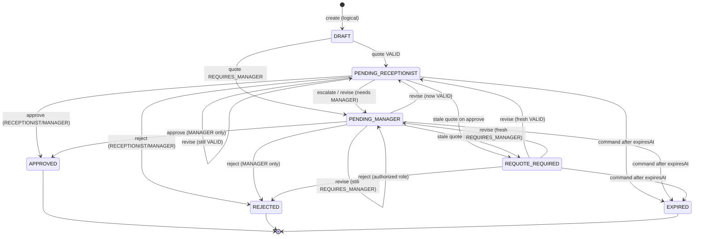

# Room upgrades — backend/domain contract (C2-CP1)

## Phạm vi và audit

Nguồn thiết kế: `TripFlix_Chot_C1_C2_C3.pdf`, mục 4, 6, 9; yêu cầu triển khai trong chat. C1 vẫn là case chính với benchmark CP2 đã khóa. Đây là tính năng mở rộng độc lập, chỉ tính và kiểm báo giá.

Tái sử dụng NestJS commerce, PostgreSQL/Drizzle, transaction host, auth/principal, CLS request trace, Zod, Vitest và Testcontainers hiện có. Không thêm dependency/framework. LLM adapter FastAPI và API client Next.js đã được rà soát nhưng không thay đổi trong CP1.

Catalog hiện có có loại phòng/giá/tồn ngày nhưng chưa có lịch sử tiền booking, trạng thái lưu trú, nhãn/version sandbox, quyền nhân viên cơ sở và điều kiện phòng sẵn sàng. Job mở lịch tự áp dụng cho catalog. Vì vậy dùng schema commerce và infrastructure chung, thêm dữ liệu sandbox `room_upgrade_*`; không seed C2 vào bảng bán phòng đang được các job/checkout sử dụng. Không có PMS theo phòng vật lý: `outOfService` là số phòng bị loại khỏi tồn khả dụng, do fixture mô phỏng cung cấp.

Tên code là `room-upgrades`, không dùng tên checkpoint làm tên feature. Bản đồ luồng/file: [feature README](../be/apps/core-api/src/modules/commerce/room-upgrades/README.md).

## Auth và quyền

Tất cả API dưới đây bắt buộc access token hợp lệ qua `@Authenticated()` hiện có. `AuthUser.userId` được đối chiếu phân công active trên server tại đúng `hotelId`; vai là `RECEPTIONIST` hoặc `MANAGER`. Vai global `superadmin` không bỏ qua phân công khách sạn.

Không có endpoint tự phân công. Body/query strict, không nhận role, amount, status, approval flag hoặc policy do client tự khai. Ngoài phạm vi trả 403 trước khi tra booking. Booking không có trong khách sạn đã được cấp quyền trả 404. Không trả PII khách; fixture không chứa tên, email hay số điện thoại thật.

## API

Namespace `/api/commerce/room-upgrades` dùng tên nghiệp vụ; thay đề xuất `/commerce/c2` để các developer dễ tìm. Gateway `/api/*` sẵn có đã chuyển tới core-api, không cần sửa Traefik.

| Method/path | Input | Kết quả |
|---|---|---|
| `GET /bookings` | Query `hotelId`, tùy chọn `roomNumber` | Booking hiện đang lưu trú theo status và thời gian server; `staffRole`, hotel, snapshot/version, requestId, isMock |
| `GET /bookings/:bookingCode` | Query `hotelId` | Booking, roomTypes/candidate IDs, inventory và rates từng ngày, policy và quyền lợi của riêng booking đó |
| `POST /quotes` | JSON bên dưới | Báo giá đã kiểm hoặc trạng thái thiếu dữ kiện/dữ liệu/không đủ điều kiện |

Tất cả phản hồi nghiệp vụ có `caseId: C2`, `requestId`, `snapshotId`, `fixtureVersion`, `isMock: true`; quote có `currency: VND`, `calculatedAt`, `expiresAt`. HTTP response dùng `Cache-Control: no-store`. POST chỉ tính toán, không lưu proposal nên không cần Idempotency-Key để chống tác động; mỗi lượt có quoteId mới.

Request ví dụ, dùng fixture neo ngày **2026-11-27**; nếu đổi ngày seed phải đổi ngày chuyển tương ứng:

```json
{
  "hotelId": "upgrade-demo-hotel",
  "bookingCode": "C2-0001",
  "targetRoomTypeId": "DLX",
  "effectiveAt": "2026-11-28T14:00:00+07:00",
  "requestType": "UPGRADE",
  "requiredFeatures": ["NON_SMOKING"]
}
```

`roomNumber` thay cho `bookingCode`, không gửi cả hai. Nhiều booking active cùng số phòng yêu cầu bổ sung bookingCode; booking đã hết thời gian ở không được chọn bằng số phòng. `targetRoomTypeId` phải là ID backend cung cấp, không phải tên do model bịa. `requestType`: `UPGRADE`, `ROOM_CHANGE`, `COMPLIMENTARY_UPGRADE`. `benefitId` tùy chọn, chỉ được dùng nếu backend xác minh là hợp lệ.

Đầu vào thiếu booking reference, target hay effectiveAt trả `NEEDS_INPUT` kèm `missingFields`, không đoán. Datetime phải có UTC offset hoặc Z; không tự hiểu ngày đơn lẻ thành số đêm/giờ chuyển. `UPGRADE` và `COMPLIMENTARY_UPGRADE` yêu cầu rank cao hơn; `ROOM_CHANGE` theo transition cho phép của policy.

Phần tiền của response thành công cho ví dụ trên (trích cấu trúc, không phải báo cáo benchmark):

```json
{
  "caseId": "C2",
  "status": "VALID",
  "currency": "VND",
  "isMock": true,
  "remainingNights": 2,
  "priceDiffVnd": 600000,
  "totals": {
    "newRoomTotalVnd": 3000000,
    "eligibleOriginalCreditVnd": 2400000,
    "additionalFeesVnd": 0,
    "additionalTaxVnd": 0,
    "eligibleDiscountVnd": 0,
    "priceDiffVnd": 600000
  },
  "validation": {"checked": true, "passed": true, "violations": []},
  "requiresHumanApproval": true,
  "approvalRole": "RECEPTIONIST",
  "operationalEffects": "NONE"
}
```

Response đầy đủ còn có quoteId, requestId, SHA-256 snapshotId, fixtureVersion, timezone, effectiveAt, calculatedAt, expiresAt, policy code/version/sources, benefit đã xác minh, `inventoryByNight`, `breakdown`, missingFields và violations. Mỗi dòng breakdown có ngày, tồn khả dụng, giá mới, giá gốc đã trả, đối trừ, phí, thuế, ưu đãi, chênh lệch, sourceRefs và version booking/inventory/rate/policy/benefit.

`VALID` chỉ là báo giá hợp lệ và vẫn chờ con người; không có `APPROVED` trong CP1. `REQUIRES_MANAGER` giữ số tiền tính được, cho chênh âm, vượt hạn mức hoặc miễn phí ngoài điều kiện. `UNAVAILABLE`, `MISSING_DATA`, `NEEDS_INPUT`, `INELIGIBLE` không có tổng tiền chính thức. `VALIDATION_FAILED` loại bỏ bảng tiền/tổng nếu bộ kiểm độc lập phát hiện sai.

## Quy tắc nghiệp vụ P0 (tất cả là giả định mô phỏng, có nguồn policy trong fixture)

- Một booking tương ứng một phòng. Status phải IN_HOUSE và server time nằm trong `[checkInAt, checkOutAt)`. EffectiveAt từ hiện tại, trong kỳ ở, trước checkout.
- Policy `FULL_LOCAL_NIGHT`: mỗi ngày địa phương từ ngày chuyển tới trước ngày checkout là một đêm đầy đủ. Chuyển giữa ngày cũng tính đêm đầy đủ do policy quy định; không chia giờ hoặc làm tròn thời lượng. Không có đêm mới vào ngày checkout. Liệt kê ngày theo lịch, không chia elapsed milliseconds/24h nên không sai ở DST. Thời điểm chuyển mơ hồ phải được bổ sung offset.
- Tồn khả dụng từng đêm = total − held − sold − outOfService; stopSell hoặc bất cứ đêm nào dưới một phòng đều chặn toàn kỳ. Không có giữ chỗ.
- Policy đang hiệu lực tại lúc báo giá và còn hiệu lực khi chuyển; chọn version mới nhất. Hai policy cùng version đang hiệu lực làm dữ liệu mơ hồ và chặn báo giá. Snapshot là một transaction repeatable-read/read-only; content hash phát hiện thay đổi cả khi nguồn chưa tăng version.
- Đối trừ dùng `creditEligibleVnd` trên từng đêm booking gốc, không vượt `paidVnd`; đây là tiền gốc đã gồm thuế. Không đọc giá niêm yết phòng cũ để tính credit. Policy có tỷ lệ đối trừ theo basis points.
- Công thức: `newRoomTotalVnd - eligibleOriginalCreditVnd + additionalFeesVnd + additionalTaxVnd - eligibleDiscountVnd`.
- Phí đổi một lần gán vào đêm đầu. Thuế chỉ cộng cho giá/phí chưa gồm thuế. Mức mô phỏng 10%; phí mặc định bằng 0 do policy ghi rõ, không phải fallback cho thiếu dữ liệu.
- Mọi tiền là số nguyên VND an toàn trong JSON. Nhân tỷ lệ và cộng tiền dùng BigInt, làm tròn half-up từng khoản tới VND theo policy. Vượt safe integer chặn báo giá; không silently clamp.
- Quyền lợi phải có verifiedAt trong quá khứ, có hiệu lực lúc báo giá và chuyển, đúng booking/hotel/target, thuộc policy cho phép. Không cộng dồn; tự chọn mức cao nhất hợp lệ, hoặc kiểm benefitId được yêu cầu. Giảm phần chênh dương trước phí/thuế theo từng đêm.
- GOLD-10 giảm 10% chênh lệch đủ điều kiện; VIP-FREE giảm 100% cho target được cho phép. Yêu cầu “miễn phí” không tạo quyền lợi hoặc sửa số tiền. Chênh âm không tạo hoàn tiền. Mọi báo giá vẫn chờ người duyệt.
- Hạn mức lễ tân mô phỏng 3.000.000đ; TTL 15 phút, giới hạn bởi thời hạn policy và checkout. Các mức này là fixture có phiên bản, không phải chính sách của khách sạn thật.
- Thiếu một ngày giá/tồn/credit hoặc policy thì tổng là null, kèm missingFields. Không thay thiếu dữ liệu bằng 0.

## Migration và fixture

Schema nguồn: `be/apps/core-api/src/modules/commerce/db/schema/room-upgrades.ts`. Migration sinh bằng lệnh có sẵn `pnpm --filter @vintrip/core-api db:generate commerce --name=room-upgrades`, thư mục `20261127163246_room-upgrades`. Chỉ thêm tám bảng sandbox với CHECK `is_mock = true`, version dương và FK có hotel scope. Không sửa migration cũ.

Chạy migration theo quy trình hiện có rồi seed rõ ràng, từ `vintrip/be/apps/core-api` sau build:

```sh
node dist/cli/seed-room-upgrades.js --date 2026-11-27 \
  --receptionist-user-id <UUID-tai-khoan-le-tan-da-co> \
  --manager-user-id <UUID-tai-khoan-quan-ly-da-co>
```

CLI chặn NODE_ENV=production, kiểm UUID/principal qua kết nối access riêng và chỉ phân công các principal được truyền vào. Không tạo tài khoản hoặc tăng global role. Không truyền UUID thì không cấp quyền ngầm. Không tự seed lúc startup. Chạy lại cùng fixture không tạo trùng/ghi đè; ngày hoặc version khác bị từ chối để tránh thay dữ liệu đang dùng. Dùng database sandbox mới để thử fixture khác.

Fixture có ba hạng STD/DLX/STE, mười booking giả định, tám booking đang ở, một đã checkout, một chưa check-in; giá/tồn tám ngày. Booking C2-0001 chứng minh chênh 600.000đ cho hai đêm, C2-0002 GOLD, C2-0003 VIP, C2-0006 quyền lợi chưa xác minh, C2-0010 chênh âm. Mọi giá, tồn, quy tắc và quyền lợi là **tự ước tính để mô phỏng**, không phải dữ liệu vận hành hoặc bằng chứng nghiên cứu.

## Kiểm tra và ranh giới checkpoint

```sh
pnpm --filter @vintrip/core-api exec vitest run src/modules/commerce/room-upgrades --maxWorkers=1
pnpm --filter @vintrip/core-api exec vitest run --config vitest.int.config.ts src/modules/commerce/room-upgrades/infra/drizzle-room-upgrade.store.int.spec.ts --maxWorkers=1
pnpm --filter @vintrip/core-api typecheck
```

Integration test mặc định dùng Testcontainers như repo. Khi chạy trong container không có Docker socket, có thể truyền `ROOM_UPGRADE_TEST_DATABASE_URL`; bắt buộc tên database riêng `room_upgrade_test_*`, tuyệt đối không dùng database vận hành. Test chạy toàn bộ migration commerce và Nest HTTP với Drizzle/transaction thật, kiểm seed idempotent, read-only, giá/tồn thay đổi, thiếu giá và bất biến bảng vận hành. Không sửa benchmark/expected/metric C1.

Acceptance CP1 kiểm các ca 1–9; ca 10 mới kiểm authority/schema ở backend, chưa phải thử model injection. Ca 13 kiểm fresh requests nhận dữ liệu mới; kiểm lúc approve thuộc CP3. Ca 16 hiện chứng minh tính báo giá không gây side effect; approve thuộc CP3. Ca 11,12,14 và phần approve chưa triển khai; ca 15 thuộc CP2. Không ghi các ca chưa triển khai là pass.

CP2 chỉ bắt đầu sau khi checkpoint này qua test. Còn phải nối LLM thật với structured extraction, năm tool nghiệp vụ, candidate allowlist, giới hạn 5 calls/2 repairs/30 giây và usage/trace thật. CP3 mới lưu proposal/revision/audit và triển khai duyệt nguyên tử; CP4 mới có UI lễ tân/eval AI. Hiện không có API approve/revise/reject và không có màn `/admin/room-upgrades`.

---

# Room upgrades — AI Copilot contract (C2-CP2)

## Phạm vi và kiến trúc CP2

CP2 bổ sung tầng AI orchestration, tool execution, guardrails và observability ngay trong FastAPI AI Service (`vintrip/ai`), không tạo microservice mới, không dùng LangGraph/RAG/vector DB, và không sao chép pricing/policy engine sang Python. Backend NestJS CP1 tiếp tục là nguồn sự thật duy nhất về quyền, tồn phòng, giá, quyền lợi, chính sách và kiểm độc lập.

Luồng tuần tự có kiểm soát:

`Authenticate (JWT + /api/auth/me) → Authorize hotel scope (Core API /bookings) → Scoped session check → Input injection guardrail → Structured Intent Extraction (LLM #1) → Resolve booking & hotel-timezone datetime → Tools (get_booking_context, get_upgrade_policy, find_available_rooms, calculate_upgrade_quote, validate_upgrade_proposal) → Recommendation & draft (LLM #2 + allowlist/price guardrails) → Structured JSON response + FinOps usage + trace`.

CP2 **không** lưu proposal, không approve/reject/revise, không giữ phòng, không đổi phòng, không sửa booking, không thu/hoàn tiền.

## Endpoint, routing và bảo mật

- Gateway (Traefik `dynamic.yml` strip prefix `/ai`): `POST /ai/room-upgrades/chat`
- FastAPI AI Service: `POST /room-upgrades/chat` (trả `Cache-Control: no-store`)
- Bắt buộc `Authorization: Bearer <accessToken>` của chính nhân viên (`401` nếu thiếu/hết hạn/thu hồi hoặc dùng service token).
- Luôn xác minh phân công khách sạn trên Core API (`GET /api/commerce/room-upgrades/bookings?hotelId=...`) **trước** khi gửi dữ liệu nghiệp vụ cho LLM (`403` cho khách hàng, nhân viên khách sạn khác hoặc global `superadmin` chưa được phân công).
- Không dùng service account đặc quyền để bypass phạm vi người dùng; không tin `role`, `userId`, `amount`, `status`, `approved` do client gửi (schema `extra="forbid"` trả `422`).
- Session theo `sessionId` gắn chặt `(ownerUserId, hotelId)`; tái sử dụng `sessionId` bởi nhân viên hoặc khách sạn khác bị chặn `403`.
- Không log `Authorization` header, Bearer token, API key hoặc raw PII.

## Request contract

```json
{
  "hotelId": "upgrade-demo-hotel",
  "message": "Khách booking C2-0001 muốn nâng từ STD lên Deluxe lúc 14 giờ ngày 28/11.",
  "sessionId": "8f3c6a71-3d21-4c76-9e7d-2f07f6a7d101",
  "selectedBookingCode": "C2-0001",
  "context": {
    "targetRoomHint": "Deluxe"
  }
}
```

- `hotelId` (bắt buộc), `message` (bắt buộc, 1–1000 ký tự).
- `sessionId` (tùy chọn UUID; tự cấp mới nếu không truyền).
- `selectedBookingCode` và `context` (tùy chọn, chỉ chứa gợi ý chưa xác thực cho lượt follow-up; mọi giá trị được kiểm lại trên backend).

## Response contract (sẵn sàng cho Staff Dashboard CP4)

Tách rõ hai lớp trạng thái:

- `workflowStatus`: `COMPLETED` | `NEEDS_INPUT` | `OUT_OF_SCOPE` | `BLOCKED_INJECTION` | `DEGRADED` | `AI_ERROR` | `DEPENDENCY_ERROR`
- `quoteStatus`: giữ nguyên enum CP1 (`VALID`, `REQUIRES_MANAGER`, `UNAVAILABLE`, `MISSING_DATA`, `NEEDS_INPUT`, `INELIGIBLE`, `VALIDATION_FAILED`) hoặc `null` khi chưa có báo giá.

Trích cấu trúc phản hồi thành công (happy path `C2-0001`, `STD → DLX`, 2 đêm):

```json
{
  "requestId": "...",
  "caseId": "C2",
  "sessionId": "...",
  "sessionContext": {
    "hotelId": "upgrade-demo-hotel",
    "bookingCode": "C2-0001",
    "targetRoomTypeId": "DLX",
    "effectiveAt": "2026-11-28T14:00:00+07:00",
    "requestType": "UPGRADE",
    "requiredFeatures": [],
    "guestPreferences": [],
    "pendingMissingFields": []
  },
  "workflowStatus": "COMPLETED",
  "quoteStatus": "VALID",
  "messageVi": "Đề xuất Deluxe hướng vườn (DLX) cho booking C2-0001: 2 đêm, chênh lệch 600.000đ (VALID). Chờ RECEPTIONIST duyệt.",
  "recommendationReasonVi": "...",
  "draftMessageVi": "...",
  "missingFields": [],
  "violations": [],
  "bookingSummary": { "bookingCode": "C2-0001", "roomNumber": "101", "currentRoomTypeId": "STD", "status": "IN_HOUSE", "guests": 2 },
  "candidates": [ { "candidateId": "DLX", "quoteStatus": "VALID", "priceDiffVnd": 600000, "remainingNights": 2, "approvalRole": "RECEPTIONIST", "requiresHumanApproval": true } ],
  "selectedCandidateId": "DLX",
  "selectedQuote": { "status": "VALID", "priceDiffVnd": 600000, "remainingNights": 2, "requiresHumanApproval": true, "operationalEffects": "NONE" },
  "policySources": [ { "ref": "STAY-UPGRADE:v1:TIME", "code": "TIME", "policyCode": "STAY-UPGRADE", "policyVersion": 1, "clause": "..." } ],
  "requiresHumanApproval": true,
  "approvalRole": "RECEPTIONIST",
  "staffRole": "RECEPTIONIST",
  "snapshotId": "room-upgrades:...",
  "fixtureVersion": "room-upgrades-v1@2026-11-27",
  "isMock": true,
  "operationalEffects": "NONE",
  "model": {
    "provider": "openai",
    "api": "responses",
    "model": "gpt-6-luna",
    "reasoningEffort": "low",
    "promptVersions": ["room-upgrades-intent.v1", "room-upgrades-recommend.v1"],
    "status": "ok",
    "degraded": false,
    "callCount": 2,
    "repairCount": 0,
    "usageStatus": "reported",
    "inputTokens": 0,
    "cachedInputTokens": 0,
    "outputTokens": 0,
    "reasoningTokens": 0,
    "costUsd": 0,
    "responseIds": ["resp_..."],
    "guardrailEvents": []
  },
  "trace": { "requestId": "...", "totalLatencyMs": 0, "steps": [], "tools": [], "modelCalls": [], "policyVersion": 1 }
}
```

## Cấu hình model, guardrails và FinOps

- Provider chính thức: **OpenAI Responses API** trực tiếp (`https://api.openai.com/v1/responses`), model `gpt-6-luna`, `reasoning.effort = "low"`, `text.format.type = "json_schema"` (`strict: true`), `store: false`. Không bật hosted tools (`web_search`, `file_search`, `code_interpreter`). Không tự fallback sang `gpt-4o-mini` hoặc provider khác.
- Cấu hình riêng qua `ROOM_UPGRADES_LLM_*` + `OPENAI_API_KEY` để không ảnh hưởng C1/C3 và chat cũ.
- Giới hạn cứng: tối đa **5 model calls/lượt**, **2 lần repair**, **30 giây** deadline toàn workflow (tính từ lúc nhận request gồm auth, backend tools và LLM); single-attempt per HTTP call (không retry ngầm ở SDK).
- Allowlist & guardrails:
  - Candidate ID chỉ lấy từ `roomTypes` của backend; từ chối ID bịa (`HALLUCINATED_CANDIDATE_ID`).
  - Nguồn chính sách kiểm theo allowlist từ backend (`HALLUCINATED_SOURCE_REF`).
  - Kiểm tra số tiền VND và tuyên bố hành động/miễn phí trong văn bản do LLM sinh (`FABRICATED_PRICE_IN_TEXT`, `UNAUTHORIZED_WAIVER_CLAIM`, `FORBIDDEN_ACTION_CLAIM`); số tiền chính thức luôn lấy trực tiếp từ backend CP1.
  - Nhất quán snapshot: nếu `snapshotId` lệch giữa `get_booking_context` và `calculate_upgrade_quote`, đọc lại và báo giá lại tối đa 1 lần; nếu vẫn lệch thì trả `SNAPSHOT_INCONSISTENT` (`MISSING_DATA`, không gộp snapshot).
  - Nếu lỗi model xảy ra ở bước Intent Extraction → trả `workflowStatus: "AI_ERROR"`, `quoteStatus: null` (không bao giờ sinh báo giá chưa xác minh). Nếu lỗi model xảy ra ở bước Recommendation sau khi backend đã kiểm báo giá → fallback deterministic an toàn có gắn nhãn `workflowStatus: "DEGRADED"`, `model.degraded: true`.
- FinOps & analytics:
  - Đơn giá chuẩn `gpt-6-luna`: input `$0.10/1M`, cached input `$0.01/1M`, output `$0.50/1M` (`reasoning_tokens` đã nằm trong `output_tokens`, không tính trùng).
  - Phát `UsageEvent` với `feature: "room_upgrades"` lên `stream:ai` cho mọi model call kể cả output lỗi/repair; thiếu usage từ provider ghi `usage_missing` (`inputTokens: null`, `outputTokens: null`), không tự bịa số.
  - `vintrip/be` analytics consumer (`AI_FEATURES`) đã bổ sung `'room_upgrades'` theo hướng tương thích ngược.

Chi tiết bản đồ code và bằng chứng kiểm thử CP2: [AI feature README](../ai/app/services/room_upgrades/README.md) · [evidence CP2](../ai/docs/evidence/room-upgrades-cp2.md).

---

# Room upgrades — HITL Approval Workflow & Proposal Contract (C2-CP3)

## Phạm vi và ranh giới CP3

CP3 bổ sung lớp lưu trữ đề xuất nâng hạng (Human-in-the-Loop) có kiểm soát transaction ngay trong module `commerce/room-upgrades` của `core-api`, kèm gợi ý payload tạo đề xuất (`proposalDraft`, chỉ đọc) ở `vintrip/ai` để sẵn sàng cho Staff Dashboard CP4.

- `APPROVED` chỉ xác nhận **nội dung đề xuất báo giá đã được nhân viên có thẩm quyền phê duyệt tại thời điểm kiểm tra**.
- **Không có tác động vận hành (`operationalEffects: "NONE"`):** không chuyển phòng, không giữ phòng, không cập nhật booking vận hành, không giảm tồn kho, không thu tiền, không hoàn tiền và không gửi thông báo thật cho khách.
- Toàn bộ bảng dữ liệu CP3 đều là sandbox (`is_mock = true` được ép bằng PostgreSQL `CHECK`), tách biệt hoàn toàn khỏi `orders`, `order_items`, `room_inventory`, `room_rates`, `payments`, `refunds` và `commerce.idempotency_keys`.
- Không xây giao diện Staff Dashboard (`/admin/room-upgrades`) trong CP3.

## Kiến trúc lưu trữ & Migration

Schema nguồn: `vintrip/be/apps/core-api/src/modules/commerce/db/schema/room-upgrades.ts`.
Migration bổ sung: `vintrip/be/apps/core-api/src/modules/commerce/db/migrations/20261127175228_room-upgrade-proposals/migration.sql` (sinh bằng `pnpm --filter @vintrip/core-api db:generate commerce --name=room-upgrade-proposals`). Không sửa migration CP1, không drop/truncate dữ liệu cũ.

4 bảng sandbox mới trong schema `commerce`:

| Bảng | Vai trò | Ràng buộc chính |
|---|---|---|
| `room_upgrade_proposals` | Aggregate đề xuất hiện hành | PK `id`; `UNIQUE (hotel_id, id)`; FK `(hotel_id, booking_code) -> room_upgrade_bookings`; `CHECK (is_mock = true AND version > 0 AND current_revision > 0 AND version >= current_revision)`; CHECK enum `status` & `role`; index hàng đợi `(hotel_id, status, updated_at)` và booking `(hotel_id, booking_code, created_at)` |
| `room_upgrade_proposal_revisions` | Snapshot báo giá bất biến theo từng revision (append-only) | PK `(proposal_id, revision_number)`; FK `(hotel_id, proposal_id) -> room_upgrade_proposals`; FK `(hotel_id, target_room_type_id) -> room_upgrade_room_types`; `price_diff_vnd` hỗ trợ số nguyên âm/dương an toàn `[-9007199254740991, 9007199254740991]` (cho ca chênh âm `C2-0010`); `CHECK (quote_status IN ('VALID', 'REQUIRES_MANAGER'))` |
| `room_upgrade_proposal_audit_events` | Nhật ký kiểm toán append-only | PK `id`; FK `(hotel_id, proposal_id) -> room_upgrade_proposals`; lưu `proposal_version`, `revision_number`, `actor_user_id`, `actor_role`, `action`, `previous_status`, `new_status`, `reason`, `reason_codes`, `request_id`, `idempotency_key_hash` (SHA-256, không lưu raw key/token/PII/prompt); index lịch sử `(hotel_id, proposal_id, created_at, proposal_version)` |
| `room_upgrade_proposal_idempotency` | Kho idempotency nguyên tử theo phạm vi sandbox | PK đặt tên tường minh `room_upgrade_proposal_idempotency_pkey (hotel_id, actor_user_id, operation, target_id, idempotency_key)`; FK `(hotel_id, proposal_id) -> room_upgrade_proposals`; lưu `payload_hash`, `http_status` (`200`, `201`, `409`), `response_body` trong cùng transaction với proposal và audit |

Phân biệt hai bộ đếm phiên bản:
- **`version`** (optimistic concurrency version trên `room_upgrade_proposals`): bắt đầu từ `1`, tăng `+1` trên **mọi** đột biến vòng đời (`revise`, `approve`, `reject`, `escalate`, `mark-expired`, `mark-requote`). Client bắt buộc gửi `expectedVersion` khớp `version`.
- **`currentRevision` / `revisionNumber`** (số thứ tự nội dung báo giá trên `room_upgrade_proposal_revisions`): bắt đầu từ `1`, chỉ tăng `+1` khi `revise` tạo revision bất biến mới. `approve`/`reject`/`escalate`/`mark-expired`/`mark-requote` chỉ tăng `version`, không bao giờ ghi đè revision lịch sử.

## State Machine

Tách biệt hoàn toàn trạng thái vòng đời proposal (`status`) với trạng thái báo giá CP1 (`quoteStatus`: `VALID` | `REQUIRES_MANAGER`).



| Từ trạng thái | Được chuyển sang | Ghi chú |
|---|---|---|
| `DRAFT` | `PENDING_RECEPTIONIST`, `PENDING_MANAGER` | Trạng thái khởi tạo logic; `POST /proposals` luôn đánh giá quote trên server và chuyển sang hàng đợi chờ duyệt phù hợp |
| `PENDING_RECEPTIONIST` | `APPROVED`, `REJECTED`, `PENDING_MANAGER`, `PENDING_RECEPTIONIST`, `EXPIRED`, `REQUOTE_REQUIRED` | Self-transition xảy ra khi `revise` vẫn cho quote `VALID` |
| `PENDING_MANAGER` | `APPROVED`, `REJECTED`, `PENDING_RECEPTIONIST`, `PENDING_MANAGER`, `EXPIRED`, `REQUOTE_REQUIRED` | `revise` có thể hạ về `PENDING_RECEPTIONIST` nếu báo giá mới đạt `VALID` |
| `REQUOTE_REQUIRED` | `PENDING_RECEPTIONIST`, `PENDING_MANAGER`, `REJECTED`, `EXPIRED` | Không thể `approve` trực tiếp khi đang `REQUOTE_REQUIRED`; phải `revise` tạo revision mới |
| `APPROVED`, `REJECTED`, `EXPIRED` | *(không có — terminal P0)* | Mọi command mới đều trả `409 INVALID_STATE_TRANSITION` (hoặc `409 VERSION_CONFLICT` nếu dùng version cũ). Muốn đề xuất lại phải tạo proposal mới |

Client/LLM không bao giờ được gửi `status`, `actorRole`, `actorUserId`, `amount`, `priceDiffVnd`, `approved` hoặc `isMock` (schema `z.strictObject` từ chối `400`).

## Ma trận phân quyền RBAC

Xác thực JWT qua `@Authenticated()`, đối chiếu `room_upgrade_staff_assignments (hotel_id, user_id, active = true)` **bên trong mỗi transaction trước cả bước tra cứu idempotency**.

| Thao tác / Endpoint | `RECEPTIONIST` (đúng hotel) | `MANAGER` (đúng hotel) | `CUSTOMER` / chưa gán / `superadmin` không có assignment / staff hotel khác / staff bị thu hồi |
|---|---|---|---|
| `POST /proposals` (create) | Được phép | Được phép | `403 HOTEL_ACCESS_DENIED` |
| `GET /proposals`, `GET /:id`, `GET /:id/history` | Được phép (chỉ trong hotel được gán; `proposalId` hotel khác → `404`) | Được phép (chỉ trong hotel được gán; `proposalId` hotel khác → `404`) | `403 HOTEL_ACCESS_DENIED` |
| `POST /:id/revise` (chưa terminal) | Được phép | Được phép | `403 HOTEL_ACCESS_DENIED` |
| `POST /:id/approve` (`PENDING_RECEPTIONIST`) | Được phép | Được phép | `403 HOTEL_ACCESS_DENIED` |
| `POST /:id/approve` (`PENDING_MANAGER` hoặc `requiredApprovalRole = MANAGER`) | `403 INSUFFICIENT_APPROVAL_ROLE` | Được phép (không bypass validator, không tự đưa số tiền về 0) | `403 HOTEL_ACCESS_DENIED` |
| `POST /:id/reject` (`PENDING_RECEPTIONIST`) | Được phép | Được phép | `403 HOTEL_ACCESS_DENIED` |
| `POST /:id/reject` (`PENDING_MANAGER` hoặc `REQUOTE_REQUIRED` yêu cầu `MANAGER`) | `403 INSUFFICIENT_APPROVAL_ROLE` | Được phép | `403 HOTEL_ACCESS_DENIED` |
| `POST /:id/escalate` (`PENDING_RECEPTIONIST`) | Được phép | Được phép | `403 HOTEL_ACCESS_DENIED` |
| Idempotency replay sau khi bị thu hồi (`active = false`) | — | — | `403 HOTEL_ACCESS_DENIED` (không trả dữ liệu replay) |

Lưu ý: `allowedActions` trong response chỉ dùng để CP4 bật/tắt nút trên giao diện; backend luôn kiểm quyền độc lập ở từng command.

## API Contract (`/api/commerce/room-upgrades/proposals`)

Mọi endpoint đều yêu cầu `Authorization: Bearer <accessToken>` (`401` nếu thiếu/hết hạn/sai), trả header `Cache-Control: no-store`. Các endpoint ghi bắt buộc header `Idempotency-Key` (chuỗi ASCII `^[A-Za-z0-9._:-]+$`, dài 8–128 ký tự; thiếu/sai trả `400 INVALID_IDEMPOTENCY_KEY`). Tham số `:proposalId` phải là UUID hợp lệ (`400 INVALID_PROPOSAL_ID`).

| Method & Path | Input | Thành công | Lỗi nghiệp vụ / xung đột chính |
|---|---|---|---|
| `POST /proposals` | Header `Idempotency-Key`; body `CreateProposalRequest` | `201 Created` (`ProposalDetailResponse`) | `400` schema/key, `403` scope, `404 BOOKING_NOT_FOUND`, `409 PREVIEW_MISMATCH` / `IDEMPOTENCY_PAYLOAD_MISMATCH`, `422 QUOTE_NOT_PERSISTABLE` |
| `GET /proposals` | Query `hotelId`, tùy chọn `status`, `bookingCode`, `requiredApprovalRole`, `limit` (`1..50`, mặc định `20`), `offset` (`0..10000`, mặc định `0`) | `200 OK` (`ProposalListResponse`) | `400` query, `403` scope |
| `GET /proposals/:proposalId` | Query `hotelId` | `200 OK` (`ProposalDetailResponse`) | `400` UUID/query, `403` scope, `404 PROPOSAL_NOT_FOUND` |
| `GET /proposals/:proposalId/history` | Query `hotelId` | `200 OK` (`ProposalHistoryResponse`) | `400` UUID/query, `403` scope, `404 PROPOSAL_NOT_FOUND` |
| `POST /proposals/:proposalId/revise` | Header `Idempotency-Key`; body `{ hotelId, expectedVersion, targetRoomTypeId?, effectiveAt?, requestType?, requiredFeatures?, benefitId?, reason?, previewExpectation?, aiMetadata? }` (`benefitId: null` để xóa ưu đãi; body giữ nguyên input hợp lệ để xác nhận báo giá mới sau `REQUOTE_REQUIRED`) | `200 OK` (`ProposalDetailResponse`) | `403` scope, `404`, `409 VERSION_CONFLICT` / `INVALID_STATE_TRANSITION` / `PREVIEW_MISMATCH` / `PROPOSAL_EXPIRED` (commit) / `IDEMPOTENCY_PAYLOAD_MISMATCH`, `422 QUOTE_NOT_PERSISTABLE` |
| `POST /proposals/:proposalId/approve` | Header `Idempotency-Key`; body `{ hotelId, expectedVersion, reason? }` | `200 OK` (`ProposalDetailResponse`) | `403 HOTEL_ACCESS_DENIED` / `INSUFFICIENT_APPROVAL_ROLE`, `404`, `409 VERSION_CONFLICT` / `INVALID_STATE_TRANSITION` / `PROPOSAL_EXPIRED` (commit) / `REQUOTE_REQUIRED` (commit) / `CONCURRENT_MODIFICATION` / `IDEMPOTENCY_PAYLOAD_MISMATCH` |
| `POST /proposals/:proposalId/reject` | Header `Idempotency-Key`; body `{ hotelId, expectedVersion, reason }` (`reason` 1–500 ký tự) | `200 OK` (`ProposalDetailResponse`) | `403`, `404`, `409 VERSION_CONFLICT` / `INVALID_STATE_TRANSITION` / `PROPOSAL_EXPIRED` (commit) / `IDEMPOTENCY_PAYLOAD_MISMATCH` |
| `POST /proposals/:proposalId/escalate` | Header `Idempotency-Key`; body `{ hotelId, expectedVersion, reason }` (`reason` 1–500 ký tự) | `200 OK` (`ProposalDetailResponse`) | `403`, `404`, `409 VERSION_CONFLICT` / `INVALID_STATE_TRANSITION` / `PROPOSAL_EXPIRED` (commit) / `IDEMPOTENCY_PAYLOAD_MISMATCH` |

Ví dụ request `POST /api/commerce/room-upgrades/proposals`:

```json
{
  "hotelId": "upgrade-demo-hotel",
  "bookingCode": "C2-0001",
  "targetRoomTypeId": "DLX",
  "effectiveAt": "2026-11-28T14:00:00+07:00",
  "requestType": "UPGRADE",
  "requiredFeatures": [],
  "previewExpectation": {
    "expectedPriceDiffVnd": 600000,
    "expectedSnapshotId": "room-upgrades:<sha256>",
    "expectedQuoteStatus": "VALID",
    "expectedApprovalRole": "RECEPTIONIST"
  },
  "aiMetadata": {
    "source": "ai_copilot",
    "sessionId": "8f3c6a71-3d21-4c76-9e7d-2f07f6a7d101",
    "aiRequestId": "...",
    "selectedCandidateId": "DLX",
    "model": "gpt-6-luna",
    "promptVersions": ["room-upgrades-intent.v1", "room-upgrades-recommend.v1"],
    "recommendationReasonVi": "...",
    "draftMessageVi": "..."
  }
}
```

Ví dụ response `ProposalDetailResponse` (`201` / `200`):

```json
{
  "caseId": "C2",
  "isMock": true,
  "operationalEffects": "NONE",
  "requiresHumanApproval": true,
  "requestId": "...",
  "hotelId": "upgrade-demo-hotel",
  "staffRole": "RECEPTIONIST",
  "proposalId": "uuid",
  "bookingCode": "C2-0001",
  "status": "PENDING_RECEPTIONIST",
  "version": 1,
  "currentRevision": 1,
  "requiredApprovalRole": "RECEPTIONIST",
  "allowedActions": ["REVISE", "APPROVE", "REJECT", "ESCALATE"],
  "reasonCodes": [],
  "expiresAt": "2026-11-27T09:15:00.000Z",
  "isExpired": false,
  "createdBy": "uuid",
  "createdAt": "2026-11-27T09:00:00.000Z",
  "updatedAt": "2026-11-27T09:00:00.000Z",
  "decidedBy": null,
  "decidedByRole": null,
  "decidedAt": null,
  "decisionReason": null,
  "targetRoomTypeId": "DLX",
  "effectiveAt": "2026-11-28T07:00:00.000Z",
  "priceDiffVnd": 600000,
  "quoteStatus": "VALID",
  "policyCode": "STAY-UPGRADE",
  "policyVersion": 1,
  "normalizedRequest": {
    "hotelId": "upgrade-demo-hotel",
    "bookingCode": "C2-0001",
    "targetRoomTypeId": "DLX",
    "effectiveAt": "2026-11-28T14:00:00+07:00",
    "requestType": "UPGRADE",
    "requiredFeatures": [],
    "benefitId": null
  },
  "quote": { "status": "VALID", "priceDiffVnd": 600000, "validation": { "checked": true, "passed": true, "violations": [] } },
  "breakdown": [],
  "policySources": [],
  "fixtureVersion": "room-upgrades-v1@2026-11-27",
  "snapshotId": "room-upgrades:<sha256>",
  "businessFingerprint": "<sha256>",
  "calculatedAt": "2026-11-27T09:00:00.000Z",
  "aiMetadata": null
}
```

Ví dụ `409 Conflict` có commit trạng thái (`REQUOTE_REQUIRED` khi nguồn thay đổi lúc duyệt):

```json
{
  "code": "REQUOTE_REQUIRED",
  "message": "Dữ liệu nguồn hoặc báo giá đã thay đổi; cần tạo revision báo giá lại trước khi duyệt.",
  "reasonCodes": ["RATE_CHANGED", "PRICE_CHANGED"],
  "proposal": { "status": "REQUOTE_REQUIRED", "version": 2, "currentRevision": 1, "expiresAt": "..." },
  "freshQuote": { "status": "VALID", "priceDiffVnd": 700000 }
}
```

## Đảm bảo Transaction, Concurrency, Stale Quote và Audit Atomicity

1. **Isolation & bounded retry:** Mọi command ghi chạy trong một transaction PostgreSQL `SERIALIZABLE` (`DrizzleRoomUpgradeProposalStore.withSerializableTransaction`) với vòng lặp retry bao ngoài transaction tối đa **3 lần** chỉ cho lỗi tạm có thể thử lại: SQLSTATE `40001` (`serialization_failure`), `40P01` (`deadlock_detected`) và `23505` trên đúng constraint `room_upgrade_proposal_idempotency_pkey`. Nếu hết 3 lượt vẫn gặp `40001`/`40P01`, trả HTTP `409 CONCURRENT_MODIFICATION`. Lỗi nghiệp vụ và lỗi ghi audit không bao giờ bị nuốt hoặc retry.
2. **Thứ tự khóa chuẩn (chống deadlock & chống TOCTOU):**
   - Bước 1: Kiểm `staffRole` trong transaction (`403` nếu mất quyền).
   - Bước 2: Tra `room_upgrade_proposal_idempotency` theo 5 thành phần `(hotelId, actorUserId, operation, targetId, idempotencyKey)`.
   - Bước 3: `SELECT ... FROM room_upgrade_proposals WHERE hotel_id = $1 AND id = $2 FOR UPDATE` + kiểm `expectedVersion` và trạng thái/RBAC.
   - Bước 4 (riêng `approve`): Khóa chia sẻ `SELECT ... FOR SHARE` theo đúng thứ tự bảng và khóa chính `room_upgrade_bookings → room_upgrade_inventory (ORDER BY date) → room_upgrade_rates (ORDER BY date) → room_upgrade_policies (ORDER BY code, version) → room_upgrade_member_benefits (ORDER BY id)`. Khóa `FOR SHARE` tương thích giữa nhiều lệnh `approve` trên các booking khác nhau nhưng ép tuần tự hóa với transaction sửa/xóa dữ liệu nguồn cạnh tranh: nếu nguồn đang bị cập nhật và commit trong lúc `approve`, PostgreSQL `SERIALIZABLE` báo `40001`, vòng retry chạy lại trên snapshot mới và chuyển đề xuất sang `REQUOTE_REQUIRED` thay vì duyệt giá cũ.
   - Bước 5: `UPDATE room_upgrade_proposals SET version = version + 1, ... WHERE hotel_id = $1 AND id = $2 AND version = $3 AND status = $4 RETURNING *` (CAS nguyên tử ở DB).
   - Bước 6: `INSERT` audit event và `INSERT` bản ghi idempotency **trong cùng transaction** trước khi `COMMIT`. Nếu ghi audit lỗi, toàn bộ transaction rollback (không thể tồn tại `APPROVED` không có audit event).
   - Transaction không bao giờ giữ mở khi chờ LLM, HTTP ngoài hay người dùng.
   - **Ranh giới cam kết:** CP3 chỉ chứng nhận báo giá hợp lệ tại thời điểm commit transaction duyệt; không giữ tồn phòng sau khi transaction kết thúc.
3. **Stale quote & expiry:**
   - `businessFingerprint` là SHA-256 của cấu trúc JSON chuẩn hóa gồm: booking (`bookingCode`, `roomTypeId`, `status`, `version`, `checkInAt`, `checkOutAt`, `guests`), `normalizedRequest` (đã sort `requiredFeatures`), `quote.status`, `approvalRole`, `remainingNights`, `policy`, `benefit`, `inventoryByNight`, `breakdown`, `totals`, `priceDiffVnd`. **Loại trừ** các trường biến động (`quoteId`, `requestId`, `calculatedAt`, `expiresAt`, `snapshotId`) để không tạo false stale conflict.
   - Mã lý do stale chính xác: `BOOKING_STATUS_CHANGED`, `BOOKING_CHANGED`, `INVENTORY_UNAVAILABLE`, `INVENTORY_CHANGED`, `RATE_CHANGED`, `POLICY_VERSION_CHANGED`, `BENEFIT_CHANGED`, `PRICE_CHANGED`, `APPROVAL_ROLE_CHANGED`, `QUOTE_INVALIDATED`, `SNAPSHOT_FINGERPRINT_MISMATCH`.
   - Khi phát hiện `REQUOTE_REQUIRED`, **không** tự gia hạn `expiresAt`; nhân viên phải gọi `POST /:proposalId/revise` trước khi hết hạn để tạo revision `N+1`. Khi `expiresAt <= now`, command chuyển trạng thái sang `EXPIRED` (commit + audit `MARKED_EXPIRED` + `409 PROPOSAL_EXPIRED`).

## Hợp đồng Idempotency

- Phạm vi khóa: `(hotelId, actorUserId, operation, targetId, idempotencyKey)` với `targetId = 'new'` cho `CREATE` và `proposalId` cho các command trên đề xuất.
- Không dùng `IdempotencyInterceptor` của `@vintrip/idempotency` vì interceptor đó ghi ngoài transaction (2 transaction, có cửa sổ crash), chạy trước kiểm phân công khách sạn và ghi vào bảng vận hành `commerce.idempotency_keys`.
- Cùng key + cùng `payloadHash`: trả nguyên trạng `httpStatus` (`200`/`201`/`409`) và `responseBody` đã commit kèm header `Idempotency-Replayed: true`, không tạo thêm revision hay audit event.
- Cùng key + khác `payloadHash`: trả `409 IDEMPOTENCY_PAYLOAD_MISMATCH`.
- Hai request `CREATE` đồng thời cùng key: một giao dịch commit, giao dịch kia gặp `23505` (`room_upgrade_proposal_idempotency_pkey`) / `40001`, rollback toàn bộ và retry đọc bản ghi đã commit để replay `201` + `Idempotency-Replayed: true`.

## Tích hợp AI CP2 → CP3 (chỉ đọc)

`POST /ai/room-upgrades/chat` giữ nguyên toàn bộ contract CP2 và cấu hình OpenAI Responses API `gpt-6-luna` (`reasoning.effort = "low"`), bổ sung trường tùy chọn tương thích ngược `proposalDraft`:
- Chỉ có giá trị khi `selectedQuote` đã qua validator backend với `status` là `VALID` hoặc `REQUIRES_MANAGER`; mọi lượt `NEEDS_INPUT`, `BLOCKED_INJECTION`, `OUT_OF_SCOPE`, `AI_ERROR`, `DEPENDENCY_ERROR` hoặc quote không có tổng tiền đều trả `proposalDraft: null`.
- `proposalDraft` gồm `{ endpoint: "/api/commerce/room-upgrades/proposals", method: "POST", requiresIdempotencyKey: true, payload }` với `payload` khớp 1-1 `CreateProposalRequestSchema` (đã bỏ key `null`, kèm `previewExpectation` và `aiMetadata` giới hạn ≤ 1.000 ký tự).
- AI Service tuyệt đối không có write/approve tool và không gọi bất kỳ endpoint ghi nào của CP3.

## Chạy Migration & Integration Test CP3

```sh
# 1. Sinh migration (nếu thay đổi schema)
pnpm --filter @vintrip/core-api db:generate commerce --name=room-upgrade-proposals

# 2. Chạy unit + HTTP tests (1 worker)
pnpm --filter @vintrip/core-api exec vitest run src/modules/commerce/room-upgrades --maxWorkers=1

# 3. Chạy PostgreSQL integration & concurrency tests trên database test riêng (TUYỆT ĐỐI không dùng DB core vận hành)
ROOM_UPGRADE_TEST_DATABASE_URL="postgres://<user>:<pass>@<host>:5432/room_upgrade_test_cp3" \
pnpm --filter @vintrip/core-api exec vitest run --config vitest.int.config.ts \
  src/modules/commerce/room-upgrades/infra/drizzle-room-upgrade.store.int.spec.ts \
  src/modules/commerce/room-upgrades/infra/drizzle-room-upgrade-proposals.int.spec.ts \
  --maxWorkers=1
```

Bằng chứng kiểm thử độc lập đầy đủ của CP3: [evidence CP3](../be/docs/evidence/room-upgrades-cp3.md).

---

# Phần CP4 — Staff Portal, End-to-End Integration & Evaluation

## 1. Endpoint đọc bổ sung ở Core API

1. **`GET /api/commerce/room-upgrades/staff-context`** (`REPEATABLE READ READ ONLY`, `Cache-Control: no-store`):
   - Yêu cầu access token hợp lệ (`401` nếu thiếu/hết hạn).
   - Trả `200` với `{ caseId: "C2", isMock: true, operationalEffects: "NONE", requestId, userId, hasAccess: boolean, assignments: [{ hotelId, hotelName, timezone, fixtureVersion, staffRole }] }`.
   - Không trả `403` cho khách hàng thông thường chưa có phân công (`hasAccess: false, assignments: []`), giúp web kiểm tra quyền hiển thị menu `"Cổng nhân viên khách sạn"` sạch sẽ không gây nhiễu lỗi mạng; global `superadmin` không có dòng phân công hoạt động tại bảng `room_upgrade_staff_assignments` vẫn nhận `hasAccess: false`.
2. **`GET /api/commerce/room-upgrades/proposals/summary?hotelId=...`** (`REPEATABLE READ READ ONLY`, `Cache-Control: no-store`, đặt route trước `:proposalId`):
   - Yêu cầu phân công khách sạn trên server (`403` nếu không được phân công).
   - Trả thống kê chính xác bằng SQL `GROUP BY status` (`inHouseBookings`, `totalProposals`, `draft`, `pendingReceptionist`, `pendingManager`, `approved`, `rejected`, `expired`, `requoteRequired`) và tối đa 5 `recentProposals` mới nhất (đã hydrate revision hiện tại và `allowedActions` theo `staffRole`).
3. **CORS & Transport hardening**:
   - `core-api` (`src/platform/http.ts`) expose thêm `Idempotency-Replayed` trong `Access-Control-Expose-Headers` để trình duyệt cross-origin (`http://localhost:3100` → `http://localhost:8080`) đọc được cờ idempotent replay.
   - `roomUpgradesApi.chatCopilot` gửi `credentials: 'omit'` khi gọi `POST /ai/room-upgrades/chat` (AI Service chỉ xác thực qua `Authorization: Bearer <token>`, không dùng cookie).

## 2. Kiến trúc Frontend Staff Portal (`vintrip/fe`)

- **API client dùng chung (`packages/api-client/src/room-upgrades.ts`)**:
  - 14 phương thức `roomUpgradesApi` đi qua `http<HttpResponse<T>>`, `parseRoomUpgradeError()`, `createLogicalCommandManager()` (giữ ổn định `Idempotency-Key` theo `(operation, resourceId, canonicalPayload)` cho retry lỗi mạng/5xx và sinh key mới khi đổi hành động/payload), khóa React Query theo `(userId, hotelId)` và 7 hook (`useStaffContext`, `useStaffSummary`, `useInHouseBookings`, `useBookingContext`, `useProposalsList`, `useProposalDetail`, `useProposalHistory`).
- **Tách biệt giao diện Khách hàng vs Nhân viên**:
  - Mọi route `/staff` và `/staff/*` gắn `robots: { index: false, follow: false }`, ẩn hoàn toàn header khách hàng, footer OTA, thanh tab di động khách hàng và widget chat Vini nổi của khách.
  - Menu tài khoản khách hàng (`header-account.tsx`) chỉ hiện mục `"Cổng nhân viên khách sạn"` khi server `GET /staff-context` trả `hasAccess === true`.
  - `auth-return.ts` cho phép `?returnTo=/staff/...` an toàn (chặn ký tự điều khiển, `..`, `\\`, `%` mã hóa).
- **6 màn hình Staff Portal (`apps/web/src/app/staff/*`)**:
  - `/staff` (`DashboardScreen`): KPI tổng quan từ server (`useStaffSummary`), banner Sandbox cố định, liên kết nhanh tới Vini Copilot và 5 đề xuất gần đây.
  - `/staff/bookings` (`BookingsScreen`): danh sách booking đang lưu trú, tìm kiếm theo mã booking/số phòng/hạng phòng, nút xem chi tiết và mở trực tiếp Vini Copilot.
  - `/staff/bookings/[bookingCode]` (`BookingDetailScreen`): chi tiết booking, bảng giá trị đối trừ từng đêm gốc, quyền lợi thành viên (phân biệt rõ `Đã xác minh` vs `Chưa xác minh`), danh mục hạng phòng.
  - `/staff/room-upgrades` (`CopilotScreen`): không gian làm việc 3 cột responsive (tab switcher dưới `1280px`), hội thoại nhiều lượt với `POST /ai/room-upgrades/chat` (`gpt-6-luna`), kiểm tra nhất quán giá văn bản AI (`hasConflictingPriceInDraft`), so sánh phương án, bảng tồn phòng & chênh lệch từng đêm, nút `"Tạo đề xuất chờ duyệt"` gửi `previewExpectation` và xử lý `409 PREVIEW_MISMATCH`.
  - `/staff/proposals` (`ProposalsListScreen`): hàng đợi đề xuất lọc theo `status`, `requiredApprovalRole`, `bookingCode` và phân trang.
  - `/staff/proposals/[proposalId]` (`ProposalDetailScreen`): hiển thị báo giá xác minh, badge phiên bản nội dung (`Revision #N`) tách biệt phiên bản đồng thời (`Version vM`), countdown tham khảo (server quyết định hết hạn), các modal xác nhận native `<dialog>` cho `APPROVE` / `REVISE` / `ESCALATE` / `REJECT`, xử lý `VERSION_CONFLICT` / `REQUOTE_REQUIRED` / `PROPOSAL_EXPIRED` (không bao giờ tự duyệt lại với version mới, không cập nhật lạc quan `APPROVED`), thông báo duyệt chuẩn `"Đã duyệt đề xuất báo giá. Chưa thực hiện chuyển phòng hoặc thu tiền."`, bảng revisions bất biến và dòng thời gian kiểm toán từ server.

## 3. Hướng dẫn chạy local, seed & đăng nhập dev

1. Chuẩn bị `vintrip/ai/.env` có `OPENAI_API_KEY` (không commit file `.env`), giữ cấu hình `ROOM_UPGRADES_LLM_MODEL=gpt-6-luna`, `ROOM_UPGRADES_LLM_REASONING_EFFORT=low`.
2. Khởi chạy stack local từ gốc repo:
   ```powershell
   docker compose -f vintrip/be/deploy/compose.vintrip.yaml --profile extra up -d --build
   ```
   *(Khi khởi tạo `ai-service`, truyền biến môi trường `OPENAI_API_KEY` từ `vintrip/ai/.env` vào tiến trình `docker compose`.)*
3. Áp dụng migration & seed dữ liệu mô phỏng (nếu chưa chạy qua service `migrate`):
   ```sh
   pnpm --filter @vintrip/core-api db:migrate
   pnpm --filter @vintrip/core-api db:seed
   ```
4. Tài khoản dev seeded (`SEED_PASSWORD=vintrip-dev-123`, mã OTP 8 số đọc qua Mailpit tại `http://127.0.0.1:8025`):
   - `member@vintrip.local` — `RECEPTIONIST` tại `upgrade-demo-hotel`.
   - `superadmin@vintrip.local` — `MANAGER` tại `upgrade-demo-hotel`.
   - `moderator@vintrip.local` — không được phân công khách sạn (dùng kiểm tra chặn `403` / Access Denied).
5. Truy cập Web tại `http://localhost:3100/staff` (Gateway tại `http://localhost:8080`).

## 4. Bộ đánh giá C2 độc lập (`eval/room-upgrades/`)

- Tách biệt hoàn toàn khỏi bộ C1 đã khóa (`eval/benchmark.csv`, `eval/metric_spec.yaml`).
- 24 ca **synthetic / authored** theo CP1 fixture `room-upgrades-v1@2026-11-27` (`8 normal`, `6 hard`, `4 missing_info_or_data`, `2 injection_or_auth`, `4 service_error_or_stale`).
- Chạy smoke và full:
  ```powershell
  python eval/room-upgrades/run_eval.py --limit 5 --max-budget-usd 0.10
  python eval/room-upgrades/run_eval.py --max-budget-usd 0.50
  ```
- Bằng chứng CP4 và nghiệm thu tổng thể CP1–CP4: [evidence CP4](evidence/room-upgrades-cp4.md), [final acceptance](evidence/room-upgrades-final-acceptance.md).
